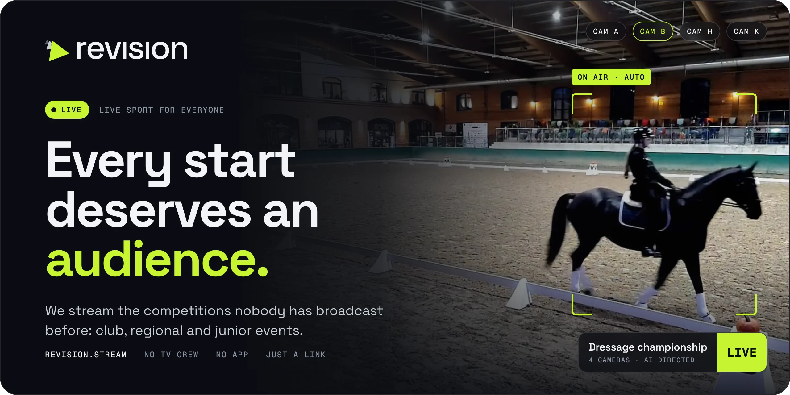
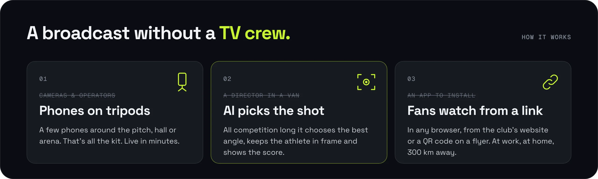
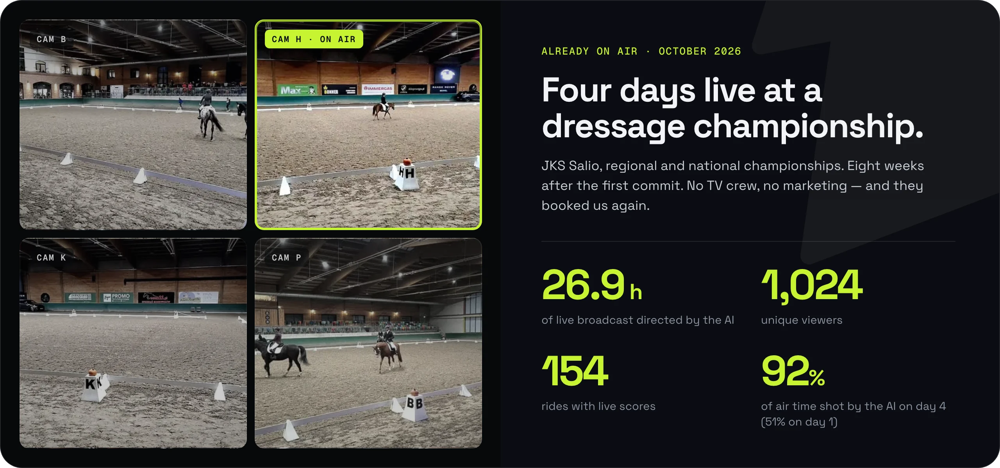
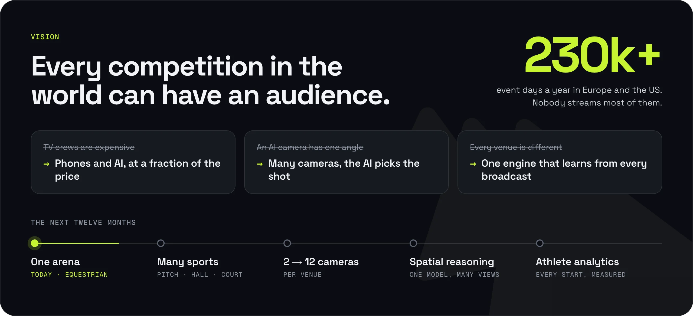
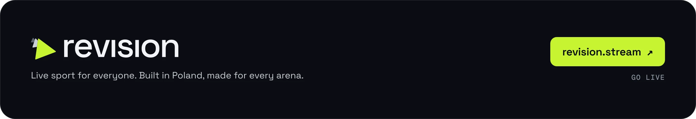

  <a href="https://revision.stream/en"><b>revision.stream</b></a>
  &nbsp;&nbsp;·&nbsp;&nbsp;
  <a href="https://revision.stream/en/events">Events</a>
  &nbsp;&nbsp;·&nbsp;&nbsp;
  <a href="https://revision.stream/en/vision">Vision</a>
  &nbsp;&nbsp;·&nbsp;&nbsp;
  <a href="https://revision.stream/en/for-organisers">For organisers</a>
  &nbsp;&nbsp;·&nbsp;&nbsp;
  <a href="https://revision.stream/en/about">About us</a>

 

**Revision streams the competitions nobody has broadcast before.** Club tournaments, regional championships, junior finals: thousands of starts every weekend that never get an audience, because an outside broadcast van and a TV crew cost more than the event itself.

We replace the van with what a club already has. A few phones on tripods around the arena, an AI director that picks the shot every second, and a link fans open in any browser. For the dad watching on a break at work, the grandma three hundred kilometres away and the teammates cheering from the sofa.

 

 

### Already on air

In October 2026, eight weeks after the first commit, we streamed four days of a dressage championship at JKS Salio. No crew, no marketing. They booked us again.

 

### Where we're heading

Over 230,000 event days a year in Europe and the US, and nobody streams most of them. We're building one engine that understands a venue seen from many cameras, learns from every broadcast, and takes us from one arena to every sport.

 

### Who we are

A small team of builders and sport insiders, eight years working together.

|  |  |
| --- | --- |
| **Rafał Wyderka** · Co-founder, CEO | Designed and built our AI engine and the AI director. |
| **Konrad Alfaro** · Co-founder, CTO | Builds the camera app, the operator studio, the viewer site and the platform. An equestrian insider. |

**Running a competition, investing, or want to build with us?** Write to [contact@revision.stream](mailto:contact@revision.stream) or follow us on [Instagram](https://www.instagram.com/revision.stream/) and [Facebook](https://www.facebook.com/revision.stream/).

 

